# 作业一

---

## 1. 欧氏变换矩阵集合构成群

题目中的矩阵为

$$
M=
\begin{bmatrix}
R&t\\
0^T&1
\end{bmatrix}
$$

其中 $R\in\mathbb R^{3\times 3}$ 满足

$$
R^TR=I,\qquad \det(R)=1
$$

且 $t\in\mathbb R^{3\times 1}$。

所有满足上述条件的矩阵构成集合 $G$。

### 1.1 封闭性

任取两个集合中的矩阵：

$$
M_1=
\begin{bmatrix}
R_1&t_1\\
0^T&1
\end{bmatrix},
\qquad
M_2=
\begin{bmatrix}
R_2&t_2\\
0^T&1
\end{bmatrix}
$$

计算它们的乘积：

$$
M_1M_2=
\begin{bmatrix}
R_1R_2&R_1t_2+t_1\\
0^T&1
\end{bmatrix}
$$

令

$$
R=R_1R_2,\qquad t=R_1t_2+t_1
$$

因为 $R_1,R_2$ 都是正交矩阵，所以

$$
\begin{aligned}
R^TR
&=(R_1R_2)^T(R_1R_2)\\
&=R_2^TR_1^TR_1R_2\\
&=R_2^TI R_2\\
&=I
\end{aligned}
$$

同时，

$$
\det(R)=\det(R_1R_2)
=\det(R_1)\det(R_2)=1\times1=1
$$

又因为 $t_1,t_2\in\mathbb R^3$，所以 $R_1t_2+t_1\in\mathbb R^3$。

满足封闭性。

### 1.2 结合律

矩阵乘法本身满足结合律。对任意 $M_1,M_2,M_3\in G$，有

$$
(M_1M_2)M_3=M_1(M_2M_3)
$$

满足结合律。

### 1.3 单位元

取

$$
E=
\begin{bmatrix}
I_3&0\\
0^T&1
\end{bmatrix}
=I_4
$$

其中 $I_3$ 满足

$$
I_3^TI_3=I_3,\qquad \det(I_3)=1
$$

所以 $E\in G$。

对任意 $M\in G$，有

$$
EM=ME=M
$$

$E$ 是集合 $G$ 的单位元。

### 1.4 逆元

任取

$$
M=
\begin{bmatrix}
R&t\\
0^T&1
\end{bmatrix}\in G
$$

因为 $R$ 是正交矩阵，所以

$$
R^{-1}=R^T
$$

因此，定义

$$
M^{-1}=
\begin{bmatrix}
R^T&-R^Tt\\
0^T&1
\end{bmatrix}
$$

验证：

$$
\begin{aligned}
MM^{-1}
&=
\begin{bmatrix}
R&t\\
0^T&1
\end{bmatrix}
\begin{bmatrix}
R^T&-R^Tt\\
0^T&1
\end{bmatrix}\\
&=
\begin{bmatrix}
RR^T&-RR^Tt+t\\
0^T&1
\end{bmatrix}\\
&=
\begin{bmatrix}
I_3&0\\
0^T&1
\end{bmatrix}
=E
\end{aligned}
$$

此外，$R^T$ 仍然是正交矩阵，且

$$
\det(R^T)=\det(R)=1
$$

平移部分 $-R^Tt$ 仍属于 $\mathbb R^3$，所以 $M^{-1}\in G$。

### 结论：欧氏变换矩阵集合构成群。

---

## 2. 哈里斯角点检测中矩阵 $M$ 的性质

题目给出的矩阵为

$$
M=
\begin{bmatrix}
\displaystyle\sum_{(x_i,y_i)\in w}I_x^2&
\displaystyle\sum_{(x_i,y_i)\in w}I_xI_y\\[6pt]
\displaystyle\sum_{(x_i,y_i)\in w}I_xI_y&
\displaystyle\sum_{(x_i,y_i)\in w}I_y^2
\end{bmatrix}
$$

其中，$I_x$ 和 $I_y$ 分别表示图像在 $x$ 和 $y$ 方向上的一阶偏导数。

### 2（a）证明矩阵 $M$ 是半正定矩阵

任取

$$
z=
\begin{bmatrix}
a\\b
\end{bmatrix}
$$

展开二次型：

$$
\begin{aligned}
z^TMz
={}&a^2\sum_w I_x^2
+2ab\sum_w I_xI_y
+b^2\sum_w I_y^2\\
={}&\sum_w
\left(a^2I_x^2+2abI_xI_y+b^2I_y^2\right)\\
={}&\sum_w(aI_x+bI_y)^2
\end{aligned}
$$

由于每一项平方都大于等于零，因此

$$
z^TMz=\sum_w(aI_x+bI_y)^2\geq0
$$

所以，对于任意向量 $z$，均有 $z^TMz\geq0$。

即矩阵 $M$ 是半正定矩阵。

### 2（b）证明正定矩阵 $M$ 所定义的曲线是椭圆

题目给出的曲线为

$$
\begin{bmatrix}x&y\end{bmatrix}
M
\begin{bmatrix}x\\y\end{bmatrix}=1
$$

由于 $M$ 是实对称正定矩阵，所以存在正交矩阵 $Q$，使得

$$
M=Q
\begin{bmatrix}
\lambda_1&0\\
0&\lambda_2
\end{bmatrix}
Q^T
$$

其中

$$
\lambda_1>0,\qquad \lambda_2>0
$$

令

$$
u=Q^T
\begin{bmatrix}x\\y\end{bmatrix}
=
\begin{bmatrix}u_1\\u_2\end{bmatrix}
$$

由于 $Q$ 是正交矩阵，所以原方程可以转换为

$$
\lambda_1u_1^2+\lambda_2u_2^2=1
$$

$$
\frac{u_1^2}{1/\lambda_1}
+
\frac{u_2^2}{1/\lambda_2}
=1
$$

因此，原方程表示一个椭圆。

### 2（c）证明椭圆半长轴和半短轴的长度

已知

$$
\lambda_1>\lambda_2>0
$$

椭圆方程为

$$
\frac{u_1^2}{1/\lambda_1}
+
\frac{u_2^2}{1/\lambda_2}
=1
$$

沿第一个特征向量方向的半轴长度为

$$
a_1=\frac{1}{\sqrt{\lambda_1}}
$$

沿第二个特征向量方向的半轴长度为

$$
a_2=\frac{1}{\sqrt{\lambda_2}}
$$

由于

$$
\lambda_1>\lambda_2>0
$$

所以

$$
\frac{1}{\sqrt{\lambda_2}}
>
\frac{1}{\sqrt{\lambda_1}}
$$

因此，椭圆的半长轴长度为

$$
a=\frac{1}{\sqrt{\lambda_2}}
$$

半短轴长度为

$$
b=\frac{1}{\sqrt{\lambda_1}}
$$

---

## 3. 证明矩阵 $A^TA$ 可逆

已知

$$
Ax=b
$$

其中，矩阵 $A$ 有 $m$ 行、$n$ 列，且 $m>n$，矩阵 $A$ 的秩为 $n$。

由于矩阵 $A$ 的秩为 $n$，说明矩阵 $A$ 的所有列向量线性无关。

所以

$$
x\in\mathbb R^n,\qquad x\neq0
$$

都有

$$
Ax\neq0
$$

矩阵 $A^TA$ 的二次型：

$$
\begin{aligned}
x^TA^TAx
&=(Ax)^T(Ax)\\
&=\|Ax\|_2^2
\end{aligned}
$$

因为 $Ax\neq0$，所以

$$
\|Ax\|_2^2>0
$$

因此，矩阵 $A^TA$ 是正定矩阵。

正定矩阵的所有特征值都大于零，所以

$$
\det(A^TA)\neq0
$$

因此，矩阵 $A^TA$ 可逆，非奇异。

---

## 4. 使用 RANSAC 拟合二维直线

### 4.1 算法步骤

1. 从全部数据中随机选取两个不同的点。
2. 根据这两个点计算一条候选直线。
3. 计算所有点到候选直线的垂直距离。
4. 将距离不超过设定阈值的点视为内点，其余视为离群点。
5. 重复采样，保留内点数量最多的模型。
6. 使用最佳模型对应的全部内点，再进行一次最小二乘拟合，得到最终直线。

### 4.2 完整 Python 实现

在 [RANSAC.py](RANSAC.py) 中。

### 4.3 实验结果

<figure>
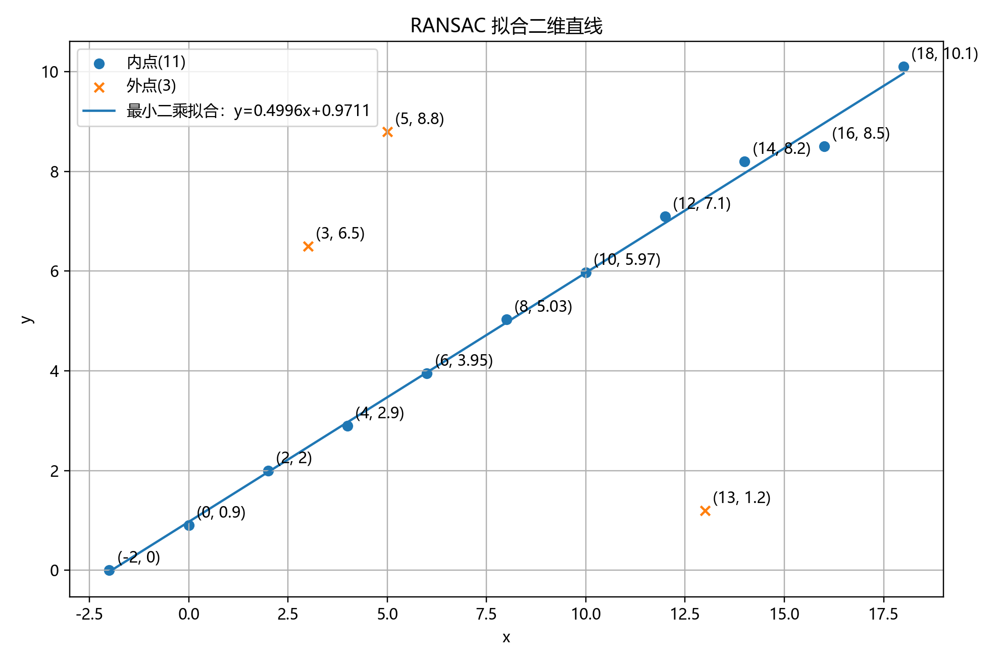
</figure>

RANSAC 最终识别出：

内点数量：11。

离群点（3个）为：$$(3,6.5),\quad(5,8.8),\quad(13,1.2)$$

距离阈值：0.5。

迭代次数：1000。

使用 11 个内点进行最小二乘重新拟合，得到：

$$
k=0.499636,\qquad b=0.971091
$$

因此，最终拟合直线为

$$
y=0.499636x+0.971091
$$

---

## 5. 使用 ORB 和 Moore-Penrose 伪逆进行图像拼接

### 5.1 实验目的与原理

本实验使用 C++ 和 OpenCV，将两张具有重叠区域的校园场景照片拼接成全景图，理解特征检测、匹配筛选、几何对齐和图像融合的完整流程，并通过 Moore-Penrose 伪逆求解单应矩阵。

ORB 提取关键点及二进制描述子，使用汉明距离衡量特征的相似程度。初步匹配经过最近邻距离比率筛选后，再用 RANSAC 排除不符合整体几何关系的匹配。

以第一张图像为参考，单应矩阵 $H$ 将第二张图像中的点映射到第一张图像坐标系。令 $h_{33}=1$，将其余八个参数组成向量 $h$，每对匹配点提供两个线性约束，组合为 $Ah=b$。通过 SVD 计算 Moore-Penrose 伪逆，得到

$$
h=A^+b.
$$

程序在 RANSAC 候选模型估计和最终内点重估中均采用这一求解方式。单应模型适合近似平面场景或相机近似绕光心旋转的情况。本实验场景包含不同深度的墙面与窗户，局部视差会影响拼接精度。

### 5.2 输入图像与 ORB 特征检测

输入文件为 `images/campus1.jpg` 和 `images/campus2.jpg`，分辨率均为 **1280 × 960**。第一张主要包含左侧墙面，第二张主要包含窗户，两幅图像在墙角和窗户附近具有重叠区域。

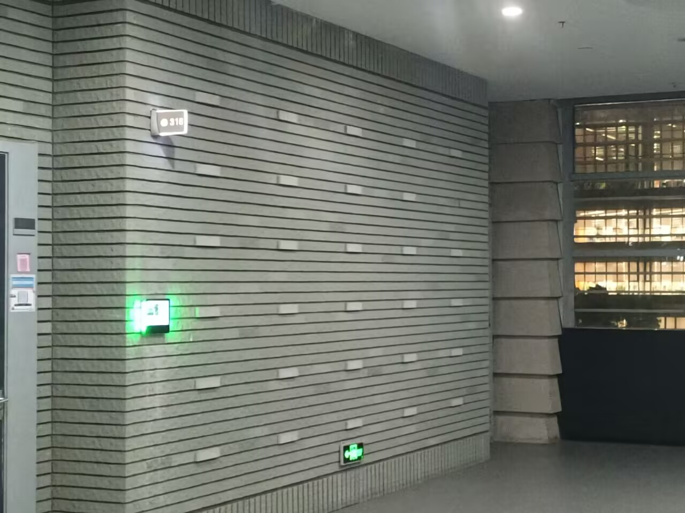

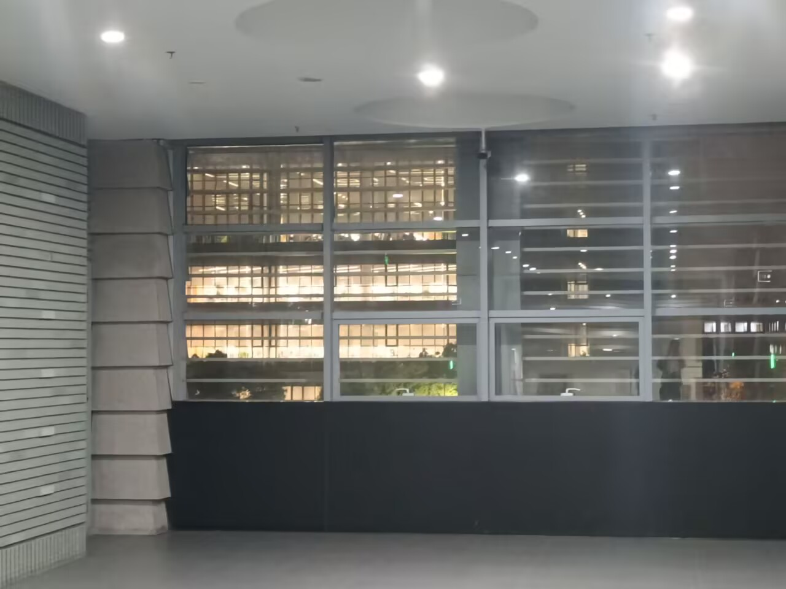

读取彩色图像后，先转为灰度图，再使用 ORB 检测关键点并计算描述子，特征点数量上限设为 **2000**。图5-3、图5-4 中的关键点主要集中在窗框、砖缝和标志牌等纹理变化明显的位置，平滑区域的特征较少。

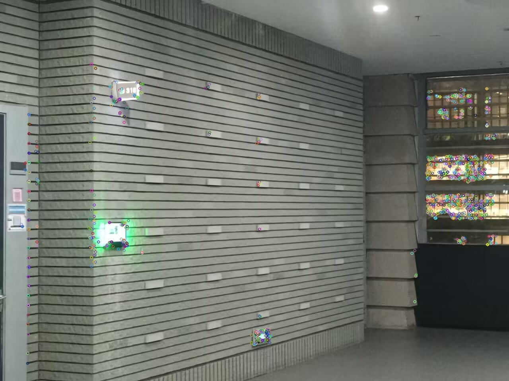

### 5.3 特征匹配与 RANSAC 筛选

使用 BFMatcher 和汉明距离，为第一张图像的每个描述子在第二张图像中查找两个最近邻。当最近邻距离小于次近邻距离的 **0.75 倍**时保留该匹配。图5-5 为比率筛选后的匹配，其中仍有部分连线偏离整体运动趋势。

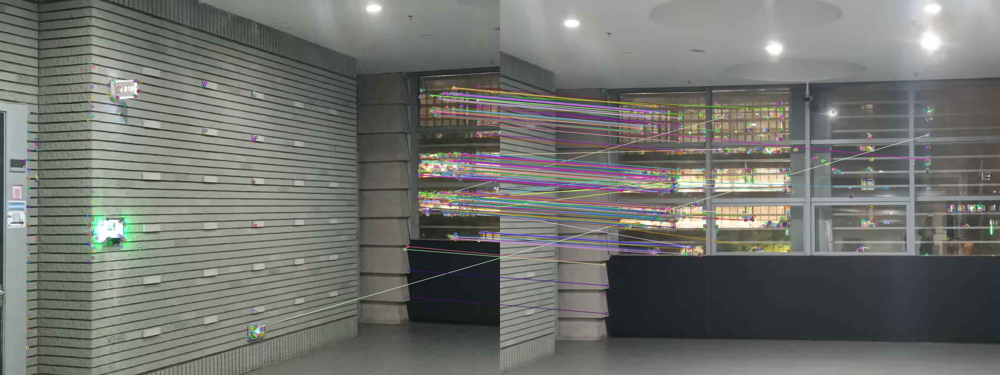

随后进行 RANSAC。每次随机选择四组不同的匹配点，通过伪逆求解候选单应矩阵，将第二张图像的点投影到第一张图像，以 **3 像素**为重投影误差阈值判断内点。经过 **3000 次**采样后，保留内点数量最多的集合，再使用这些内点通过伪逆重新估计 $H$，随机种子固定为 42。

图5-6 为 RANSAC 保留的内点匹配。与图5-5 相比，明显偏离整体方向的连线减少，匹配主要集中于重叠的窗框区域，为透视变换提供几何约束。

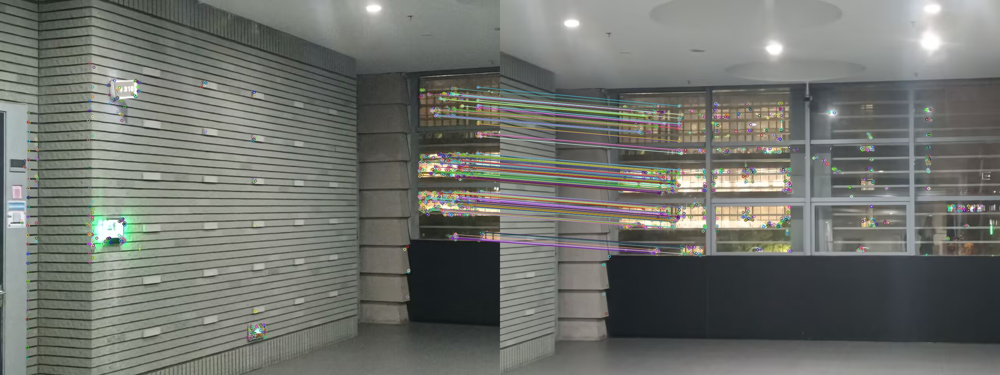

### 5.4 透视变换与公共画布

将第二张图像的四个角点通过 $H$ 投影，与第一张图像的边界一起确定画布范围。引入平移矩阵 $T$ 容纳负坐标，第一张图像使用 $T$，第二张图像使用 $TH$，通过透视变换放入同一画布。

图5-7、图5-8 展示了两幅图像在公共画布中的位置。第一张图像整体平移，第二张图像发生透视变形，使重叠内容能够在同一坐标系下融合。画布大小为 **2231 × 1144**，黑色部分表示图像未覆盖的区域。

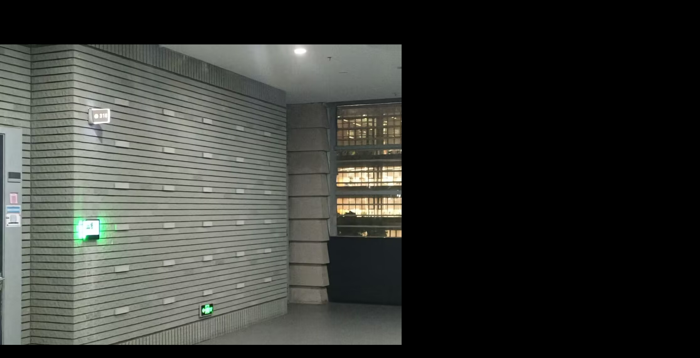

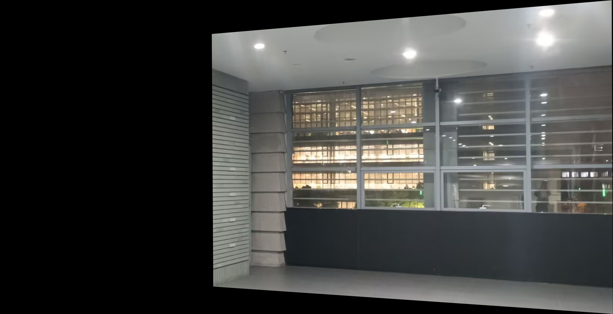

### 5.5 渐变融合与有效区域裁剪

分别建立两张图像的有效区域掩码，并使用相同的几何变换映射到画布。只有一张图像覆盖的位置直接采用对应像素，两张图像重叠的位置进行线性渐变融合。从每行重叠区域的左边界到右边界，逐渐增大第二张图像的权重，融合关系为

$$
I(x,y)=(1-\alpha)I_1'(x,y)+\alpha I_2'(x,y),
\qquad \alpha=\frac{x-l(y)}{r(y)-l(y)}.
$$

其中 $l(y)$、$r(y)$ 为该行重叠区域的左右边界，$I_1'$、$I_2'$ 为变换后的图像。当该行重叠区域只有一个像素时，取 $\alpha=0.5$。

图5-9 为渐变融合结果。左侧墙面与右侧窗户被整合到同一画面，重叠区域通过权重变化形成过渡，上下边缘仍保留透视变换产生的黑色空白。

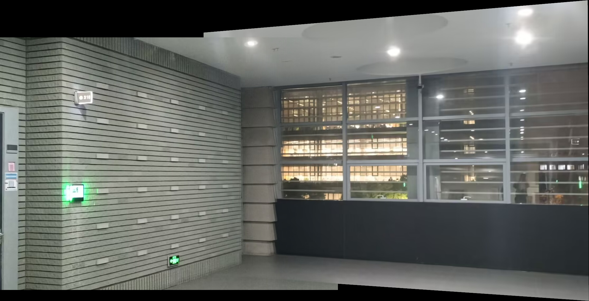

将两幅变换后的掩码取并集，得到图5-10。白色表示至少有一幅图像提供有效像素，黑色表示无图像覆盖。程序依据有效掩码搜索最大的内部矩形，并据此裁剪融合结果。

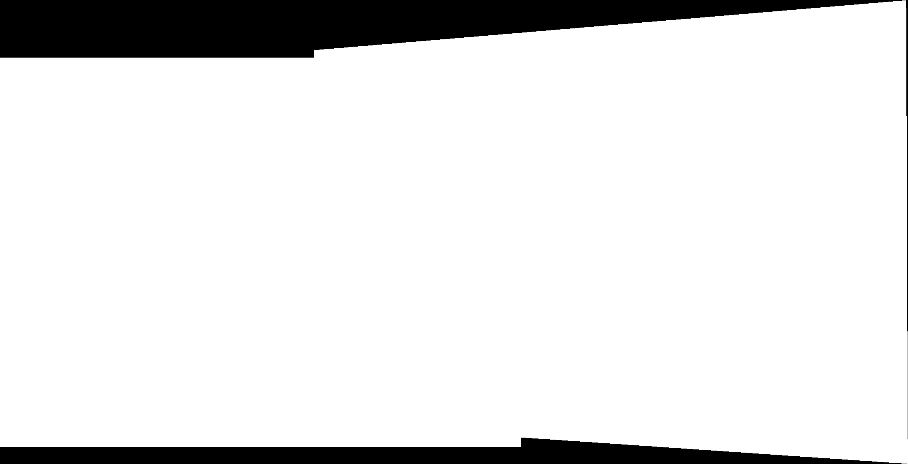

### 5.6 最终结果与分析

图5-11 为裁剪后的全景图，分辨率为 **2227 × 936**。结果同时保留了第一张图像的左侧墙面和第二张图像的右侧窗户，视野得到扩展，外围空白基本被移除。

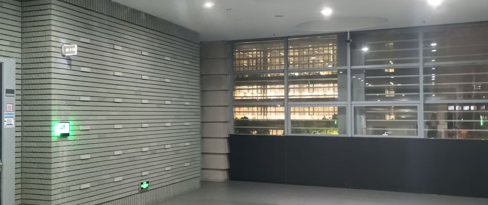

从图中可以看出，窗框和墙角附近的主要结构总体能够衔接，说明 ORB 匹配、RANSAC 筛选和伪逆估计得到的单应矩阵实现了主要重叠内容的对齐。渐变融合缓和了亮度过渡，但局部仍可见错位、重影及亮度差异。场景具有不同深度，单一单应矩阵难以同时精确描述所有区域，像素权重融合也无法消除几何误差。

本实验完成了特征检测、匹配筛选、鲁棒单应矩阵估计、透视变换、渐变融合和裁剪，核心求解过程显式计算 $A^+$，再使用 $h=A^+b$ 得到模型参数。

### 5.7 实现文件

完整 C++ 实现位于 [panorama_stitching/main.cpp](panorama_stitching/main.cpp)。输入图像保存在 [panorama_stitching/images/](panorama_stitching/images/)，上述过程图及最终结果保存在 [panorama_stitching/outputs/](panorama_stitching/outputs/)。
